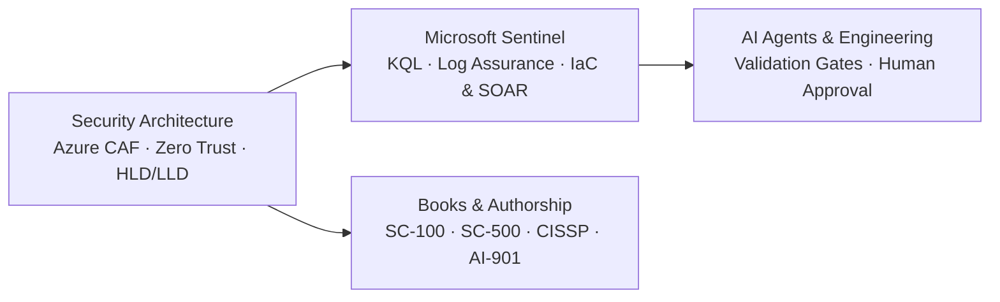

# Surya — Cybersecurity Architect | Microsoft Sentinel & AI Agents | Technical Author

I design security architectures, develop Microsoft Sentinel detections and automation, and build AI agents with explicit controls and evaluation. I write CISSP and Microsoft certification learning resources, and maintain an algorithmic trading research practice.

Currently **Manager 2 – Cybersecurity at EY GDS** with **11+ years** of enterprise security experience (including 7.5 years at **Accenture** and 3.5 years at **Cognizant**). My production track record includes leading Microsoft Defender posture remediation across **6,000+ endpoints** (improving Secure Score from **52% to 73%** six weeks ahead of schedule), governing **1,000+ legacy SIEM detection migrations**, implementing **12 production SOAR playbooks**, and reducing high-severity alert false positives by **~40%**.

---

## Featured Engineering & Architecture Work

### 1. [Microsoft Sentinel Detection Engineering & Log Assurance](https://github.com/86sunbot/portfolio/blob/main/sentinel.md)
*Primary Focus: SIEM Architecture, Governed AI Agent Engineering & Telemetry Validation*
- **Problem:** Enterprise SIEM teams struggle with silent telemetry drop-offs, unassociated Data Collection Rules (DCRs), and slow or error-prone translation of threat requirements into validated KQL rules.
- **My Contribution:** Solo architect and engineer of two complementary platforms:
  - **[AI-Assisted Sentinel Detection Engineering Agent (V3.4)](https://github.com/86sunbot/portfolio/blob/main/ai-agents.md#1-ai-assisted-microsoft-sentinel-detection-engineering-agent-ai-agent-usecase-deployment-v34):** Converts threat specifications into Microsoft Sentinel analytics rules using workspace schema discovery, deterministic KQL syntax/anti-pattern checks, historical backtesting, SHA-256 readiness verification, and human-gated `enabled=false` deployment (ARM & Terraform).
  - **[Sentinel Log Validation Agent](https://github.com/86sunbot/portfolio/blob/main/sentinel.md#1-sentinel-log-validation-agent-sentinel-log-validation-agent) & [Sentinel-as-a-Service](https://github.com/86sunbot/portfolio/blob/main/sentinel.md#2-sentinel-as-a-service--greenfield-deployment-kit--orchestrator-sentinel-as-a-service):** 3-way asset reconciliation (`SHADOW` / `SILENT` / `UNASSOCIATED_DCR`), synthetic canary verification, ASIM compliance scoring, FinOps tier optimization, and a 10-stage greenfield PowerShell 7 / ARM orchestrator.
- **Status & Evidence:** Working engineering prototypes verified by **185 offline `pytest` cases** (`ai-agent-usecase-deployment`), **130 `pytest` cases** (`Sentinel-Log-Validation-Agent`), **23 Pester v5 tests** (`Sentinel-as-a-Service`), and **6 CI-validated MITRE ATT&CK v14 detection rules** (`sentinel-detection-engineering`).

### 2. [Cell & Gene Therapy (CGT) Patient-to-Batch Orchestration](https://github.com/86sunbot/FDE-Final-Capstone)
*Primary Focus: Deterministic State Machines, Bitemporal Auditability & Forward Deployed Engineering*
- **Problem:** A brownfield patient-to-batch orchestration baseline suffered from fail-open exception handling, single-timestamp state overwrites on out-of-order lab events, and unauthenticated role elevation.
- **My Contribution:** Engineered a clean-sheet Python orchestration engine (`src/fde_capstone/`), FastAPI service, and interactive operations console implementing fail-closed state transitions, explicit three-state gate evaluation (`satisfied` / `not-satisfied` / `unknown`), bitemporal history, header-bound 7-persona RBAC/ABAC with PHI masking, and a SHA-256 hash-chained tamper-evident SQLite audit log.
- **Status & Evidence:** Public 21-stage AI FDE academic simulation capstone (**non-clinical, synthetic data**); verified in GitHub Actions CI across Python 3.11 & 3.12 with **118 passing `pytest` tests** and **96% source coverage**.

### 3. [Azure Security Architecture Framework & Technical Books](https://github.com/86sunbot/portfolio/blob/main/security-architecture.md)
*Primary Focus: Cloud Security Reference Designs, Zero Trust & Technical Authorship*
- **Problem:** Security architects and certification candidates need implementation-grade reference designs that connect protocol mechanics, Azure Policy (`Audit` / `Deny` / `DeployIfNotExists`), Entra ID Conditional Access, Private Link networking, encryption hierarchies (PMK/CMK/CPK), and Unified SecOps.
- **My Contribution:** Solo author of the **Azure Security Framework** reference guides, the **[Enterprise AI/DR: Microsoft Security vs. CrowdStrike Falcon](https://github.com/86sunbot/fde-lab/blob/main/microsoft_vs_crowdstrike_ai_dr_guide.md)** architectural benchmark, and **1,770+ pages** of original technical books and lab runbooks.
- **Status & Evidence:** Completed v1.1 reference editions and templates ([Catalogue & Previews →](https://github.com/86sunbot/portfolio/blob/main/books-and-learning.md)).

---

## Portfolio Navigation (5 Practice Categories)

The [**`86sunbot/portfolio`**](https://github.com/86sunbot/portfolio) repository serves as the authoritative index of my work, with each project assigned a single canonical home:

| Category | Focus & Canonical Projects | Explore |
| :--- | :--- | :--- |
| **1. Security Architecture** | Azure CAF landing zones, Conditional Access persona matrices, Hub-Spoke segmentation, PMK/CMK/CPK encryption, Azure Policy governance, and 20-section HLD/ADR templates. | [**`security-architecture.md`**](https://github.com/86sunbot/portfolio/blob/main/security-architecture.md) |
| **2. Microsoft Sentinel** | Deterministic log onboarding assurance, greenfield ARM/PowerShell 7 deployment wizard, MITRE ATT&CK v14 KQL detection library, and Managed-Identity Logic App SOAR playbooks. | [**`sentinel.md`**](https://github.com/86sunbot/portfolio/blob/main/sentinel.md) |
| **3. AI Agents & Applied Engineering** | Governed Sentinel detection engineering agent (V3.4), fail-closed CGT orchestration capstone, pre-GxP clinical report triage prototype, LLM/RAG threat models, and FDE lab benchmarks. | [**`ai-agents.md`**](https://github.com/86sunbot/portfolio/blob/main/ai-agents.md) |
| **4. Books & Learning** | Full-length technical guides, architecture blueprints, hands-on lab runbooks, and CISSP domain mappings. | [**`books-and-learning.md`**](https://github.com/86sunbot/portfolio/blob/main/books-and-learning.md) |
| **5. Algorithmic Trading Research** | Separate personal quantitative research practice exploring multi-indicator confluence (`RSI+ADX`, `MACD+Renko`, `CPR`) and reproducible Python backtesting on NSE data. | [**`trading-research.md`**](https://github.com/86sunbot/portfolio/blob/main/trading-research.md) |
| **Experience & Verified Impact** | 11+ year career timeline (EY GDS, Accenture, Cognizant), quantified enterprise delivery outcomes, and verified credentials. | [**`experience-and-impact.md`**](https://github.com/86sunbot/portfolio/blob/main/experience-and-impact.md) |

---

## Selected Books & Learning Resources

| Title & Edition | Curriculum / Objective Baseline | Scope & Artifacts | Status |
| :--- | :--- | :--- | :--- |
| ***Microsoft Security Architect Master Blueprint (Surya Edition v1.1)*** | Oct 2026 SFI & Unified SecOps (`SC-100`, `SC-500`, `SC-200`, `SC-300`, `SC-401`) | **958 pp.** · 12 chapters, 10 appendices, 150 diagrams, 109 ADRs, 6 labs | Completed Digital Edition (Oct 2026) |
| ***Microsoft SC-500: Cloud & AI Security Engineer Complete Study Guide (v1.1)*** | Exam `SC-500` May–July 2026 Study Guide (100% of 87 sub-objectives) | **434 pp.** · 26 technical + 4 revision chapters, 27 diagrams, 28 labs | Completed Digital Edition (Oct 2026) |
| ***Surya Master CISSP Guide (1st Consolidated Edition)*** & ***Mindmaps*** | ISC2 CISSP Exam Outline (Effective **April 15, 2024**, All 8 Domains) | **382 pp.** (`121,547` words, 500 concept cards) + **9-page** Mindmaps + `cissp-knowledge-base` | Completed Digital Edition (Oct 2026) |
| ***Microsoft Azure AI Fundamentals (AI-901) Master Study Guide*** | 2026 Microsoft Foundry, Foundry Tools & Responsible AI Syllabus | **38 pp.** (7 concept groups + cheat sheet) & **9-page** Concise Review Aid | Completed Study Guides (Aug–Oct 2026) |
| ***Enterprise AI/DR: Microsoft Security vs. CrowdStrike Falcon*** | Comparative SIEM, XDR, Identity & Agentic SecOps Architecture | **490-line** technical benchmark guide | [**Read Public Guide →**](https://github.com/86sunbot/fde-lab/blob/main/microsoft_vs_crowdstrike_ai_dr_guide.md) |
| ***How NOT to Design Microsoft Sentinel*** | Enterprise SIEM Architecture, DCR Transformation & Detection Anti-Patterns | Practitioner architecture publication | [**Read on LinkedIn →**](https://www.linkedin.com/feed/update/urn:li:activity:7434462569752571904/) |

---

## Verified Credentials & Contact

- **Active Certification:** [**CISSP — Certified Information Systems Security Professional (ISC2)**](https://www.credly.com/badges/5c478c9e-77f0-4227-9251-69ecb1d639e5) *(Verified Credly Badge · Issued 16 Jan 2026 · Expires 31 Jan 2029)*
- **Awards:** *P5 Master Expert — Cloud Security Architecture* (Accenture) · *Accenture Celebrates Excellence (ACE) Award* (2020, 2024) · *Associate of the Quarter* (2016–2018, Cognizant)
- **Education:** B.Tech in Computer Science & Engineering, Pondicherry University (2015)
- **LinkedIn:** [linkedin.com/in/surya-ps-cissp-a5a097160](https://www.linkedin.com/in/surya-ps-cissp-a5a097160/)
- **Location:** Bengaluru, India
